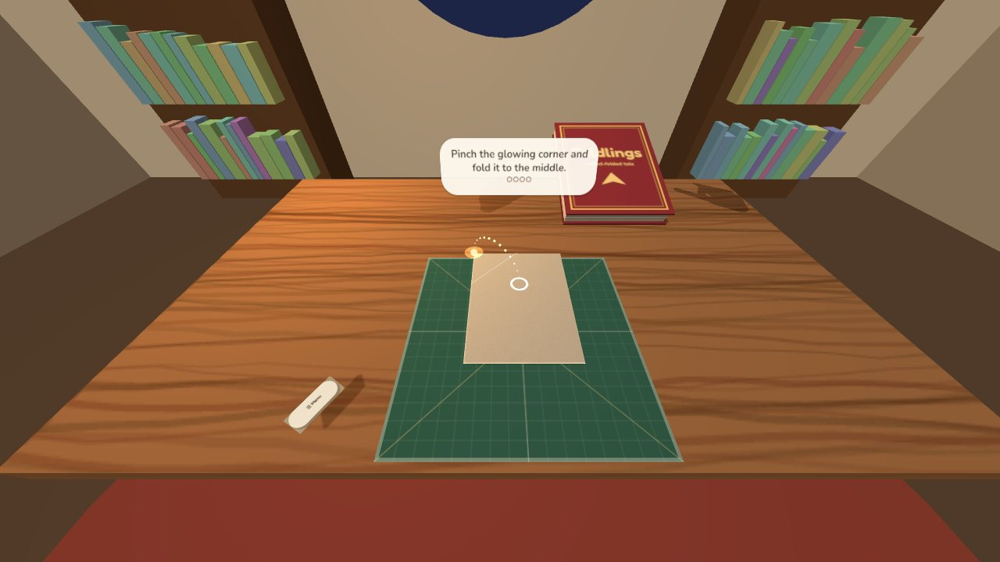
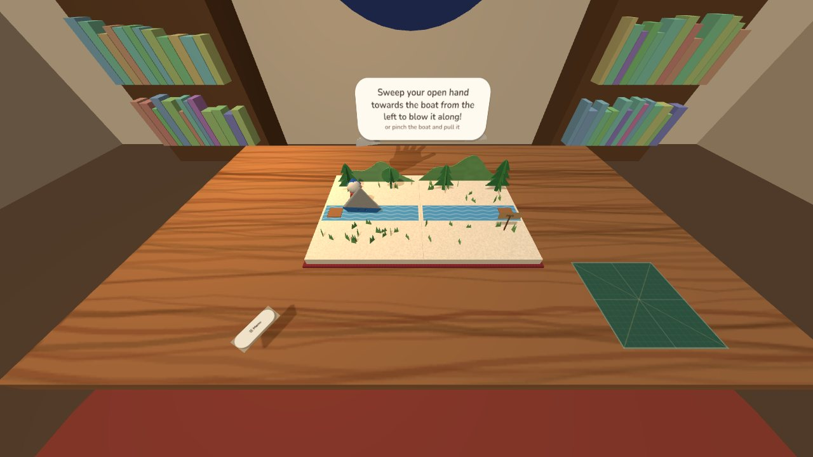
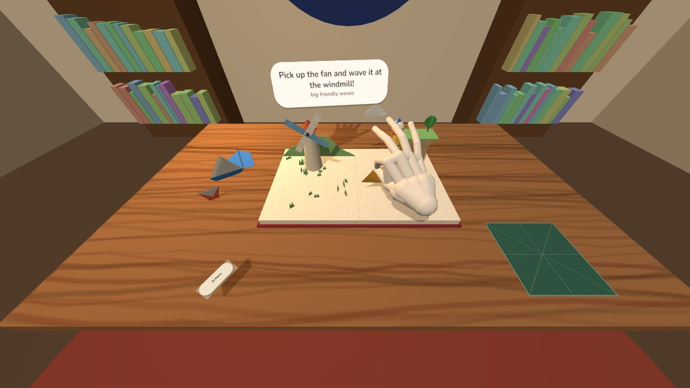
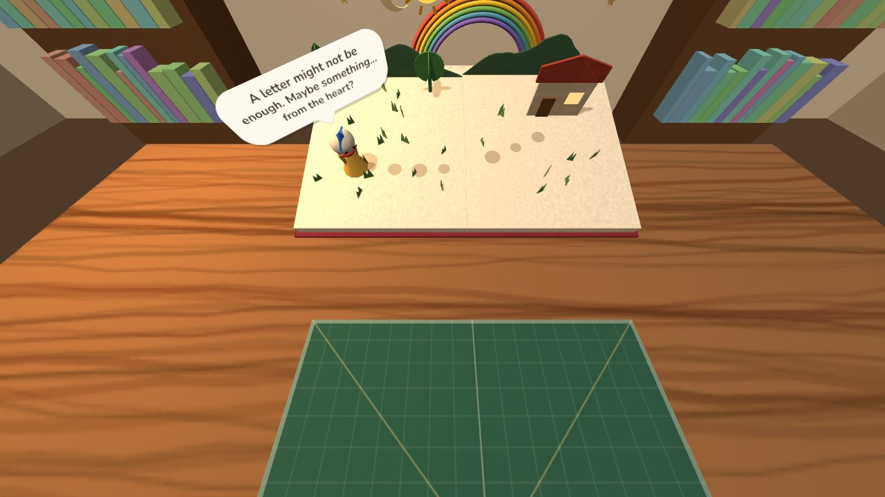

# Foldlings

**Fold paper with your bare hands, and whatever you fold comes alive.**

Foldlings is a hands-only mixed reality origami adventure for **Meta Quest 3 / 3S** and **Meta VR
Glasses**, built with Meta's **Immersive Web SDK (IWSDK)**. A pop-up storybook opens on your real
table. Inside it, Kit, a tiny paper messenger, has a letter for a friend at the end of the book.
Every page has a problem, and you fold the helper Kit needs: a paper plane, a sailboat, a cup, a
fan, a heart. The paper you fold, with your own creases and colours, wakes up, draws its own eyes
and gets to work.

Entry for the **Meta VR Start Developer Competition 2026**, Gaming track, New Experience division.

| | |
|---|---|
|  |  |
|  |  |

<sub>Captured in Meta's IWER emulator in VR mode (the cozy study). In mixed reality the desk is
your own table.</sub>

---

## Play it

1. Open the hosted link in the **Meta Quest Browser** (see *Deploy* below).
2. Tap **Enter Mixed Reality** (or **Enter VR** for a cozy virtual study).
3. Sit at a table if you have one. No controllers are needed, but they work too (trigger = pinch).

| Gesture | What it does |
|---|---|
| **Pinch** the glowing corner and move your hand | fold. The flap follows your hand around the crease. Let go past halfway and it snaps. |
| **Pinch** a Foldling | pick it up. Rotate your hand to tilt it (pouring water, for example). |
| Quick **toss** | throw the paper plane (letting go right over the book works too) |
| **Wave** your open hand | blow wind at the sailboat; a fan makes stronger wind |
| **Poke** with a fingertip | press paper-tag buttons; tickle a Foldling |
| **Pinch** the page corner and sweep left | turn the page |
| Point and **pinch** | press a button from a distance |

The story takes about 12 minutes: a prologue and four chapters. Afterwards the hub has **Free fold**
(10 models), the **Daily fold** (a model and paper colour picked from the date, with a streak), and your
saved Foldlings living on the desk. The ☰ Menu tag on the desk can **skip a fold**, move the desk, or
return to the menu.

### Why it is built this way (judging criteria)

- **Hands-first by nature.** Folding paper is the archetypal thing hands do. Every interaction is a
  pinch, poke, toss or wave, all within about 45 cm of a seated player (the "airplane seat test").
- **Satisfying in 10 minutes or less, easy in and out.** The first fold happens within about 20
  seconds, and the first creature is alive and flying in about 2 minutes. Progress saves after every
  chapter, and opening the system menu or taking the headset off pauses everything, sound included,
  until you're back.
- **Purposeful passthrough.** The book sits on *your* table (plane detection, or lay your palm flat
  on the table to place the desk), paper casts real shadows on it, and your real hands appear in
  front of the virtual paper (depth-only hand occluders). A **persistent spatial anchor** remembers
  where your desk was. Your **room's detected surfaces and walls** join in: toss the paper plane and
  it bumps off your real wall, lands on your sofa or floor, then flies home.
- **Reasons to come back.** Daily fold and streak, a growing desk of Foldlings that remember you,
  and ten models to collect.
- **FoV-aware.** Everything happens in one compact zone (mat, then the book slides close) that fits
  the VR Glasses' field of view (37° left/right, 25° up, 43° down). `scripts/e2e/fov-check.mjs`
  measures it: with the head tilted about 25° towards the desk, the paper, the book, the hints, the
  menu tag and a waiting Foldling all stay inside those bounds. At runtime the hint card reads the
  headset's own projection every frame and slides into a comfortable cone of *that* device's view.
- **Accessible.** One-handed, either hand, seated. Captions are on by default. Every physical
  challenge has a fallback: drag instead of wave, the plane flies itself after a while, Kit fetches
  the heart, and pages can auto-turn. *Skip this fold* is always available. **Large text** (Settings)
  scales the hint cards and Kit's speech bubbles, and captions can be turned off.
- **Safe on slower devices.** If the frame rate stays low, the game lowers its own quality step by
  step (foveation, a smaller shadow map, then no sun shadow) and never raises it again.

---

## Run locally

Requires Node 20.19+ or 22.12+.

```bash
npm install
npm run dev          # IWSDK dev server + emulator (desktop browser), https://localhost:8081
```

On a headset on the same Wi-Fi, open the network URL printed by `npx iwsdk dev status` and accept
the local certificate warning.

Other scripts:

```bash
npm test             # fold-engine unit tests (vitest)
npm run typecheck
npm run build        # production build → dist/
npm run models       # renders every model's fold sequence to docs/model-sheets/*.png
npm run e2e          # full story playthrough with emulated hands (run `npm run build` and
                     # `npx playwright install chromium` first)
```

Useful URL parameters (the emulator is loaded only on request):

| Parameter | Effect |
|---|---|
| `?emulate=quest3` / `?emulate=glasses` | Meta's IWER headset emulator (also `&input=controller`) |
| `&autostart=vr` / `&autostart=ar` | enter the session immediately (with `emulate`) |
| `&scene=story:2` | jump to a chapter (`story`, `menu`, `free:cup`, `daily`, `viewer`, `lab:heart`) |

## Deploy (GitHub Pages)

`.github/workflows/deploy.yml` typechecks, tests and builds, then publishes `dist/` on every push to
`main`, or on demand from **Actions → Deploy to GitHub Pages → Run workflow**. One-time setup:
**Settings → Pages → Build and deployment → Source: GitHub Actions**. On a free GitHub plan, Pages
needs a public repository. The alternative is any static host, for example Vercel: import the repo,
build command `npm run build`, output directory `dist`. The app uses relative paths and works from
any sub-path. Everything is bundled, so it does not depend on a CDN at runtime.

**Judging freeze:** the competition judges the entry as it was at the deadline (Nov 18, 2026,
12:00 PM PT), and the hosted build must stay up until the winners are announced (about Dec 11). The
workflow refuses to deploy after the deadline unless you run it manually with *after_deadline*
ticked, which is only for restoring the judged build.

---

## How it works

```
src/
  fold/          pure-TS origami engine (no Three.js), unit tested
    geom.ts        2D isometries, polygon splitting, overlap tests
    paper.ts       facets in paper space + transform into the folded frame,
                   crease splitting, connected-flap selection, layer stacking, 3D hinges
    model.ts       step DSL (fold point→point, along a line, flips, shaping hinges)
    models/        plane, sailboat, cup, fan, heart, puppy, kitten, fox, whale, tulip
  render/        paper meshes (front/back faces, crease and ink textures), FK for hinges,
                 sparkles, lighting, passthrough shadow catcher, VR study
  xr/            hand tracking (joints, pinch with grace window, rays, controllers),
                 hand occluders, desk placement (planes / palm / anchors), IWER emulation
  game/          fold controller (drag → angle around the crease), Foldlings, Kit & Mo,
                 the pop-up book and its four spreads
  scenes/        story, hub, free/daily fold, idle showcase, dev scenes
  audio/         procedural sound effects, voices and a generative music box (Web Audio)
```

### The fold engine

Each facet keeps its polygon in **paper space** plus an isometry into the **folded frame**. A fold
is defined by a crease line and a grabbed point. The engine splits every facet along the crease and
picks the moving set: the whole side, the **connected flap** (flood fill over paper-space
adjacency, so connected layers move together and folds stop exactly at real creases), or a named
region. It then reflects the moving set and stacks it on top (valley) or underneath (mountain).
Partial folds become 3D hinges with forward kinematics (plane wings). Stack heights are computed
from local overlap, so single flaps stay paper-thin. Because creases and ink are drawn in paper
space, they land correctly however the sheet is folded.

During a drag, the flap angle is the angle of your hand *around the crease axis*. Lifting over the
crease and simply dragging across both work, and a critically damped spring smooths tracking
jitter.

### Verification

- `npm test`: 34 tests (geometry, folding, area conservation, every model step, eye visibility,
  hinges, the script runner, save data and the story's fold budget).
- `npm run models`: contact sheets of every fold step (`docs/model-sheets/`).
- `node scripts/e2e/playthrough.mjs quest3 [chapter]`: plays the story in headless Chromium with
  Meta's IWER headset emulator and scripted hands. It folds every model by pinching and dragging,
  tosses the plane into the book, places and sails the boat by waving, dips and pours the cup, fans
  the windmill, gives the heart, turns every page and opens the final letter, then saves screenshots
  under `test-results/`. The full run (prologue to hub) passes with no console errors and without
  any accessibility fallback (impatient plane, auto page turn, and so on) stepping in; the script
  fails if one does.
- `node scripts/e2e/modes.mjs`: pokes through the hub with an emulated fingertip into Free fold
  (the puppy), the Daily fold and Settings, and checks the save data, the desk shelf and the streak.
- `node scripts/e2e/room-check.mjs`: a synthetic room (floor, sofa, wall) in mixed reality. A
  tossed plane must stop at the wall, rest on the floor, land on the sofa seat, and fly home.
- `node scripts/e2e/pause-check.mjs`: the system menu and headset-off states freeze game time and
  sound, and the game resumes afterwards.
- `node scripts/e2e/perf.mjs`: draw calls and triangles per scene in an emulated session. The busiest
  scene (the garden spread) is about 170 draw calls and 25k triangles per frame for both eyes,
  including the shadow pass. Most scenes are lower.

**Not yet verified on physical hardware.** Frame rate, hand-tracking feel and passthrough placement
need a real Quest.

## Credits

- Built with the [Immersive Web SDK](https://iwsdk.dev) (MIT) and Three.js (MIT).
- Fonts: Fredoka and Nunito (SIL Open Font License, see `public/fonts/`).
- All models, art, sound and music are procedural and original to this project.
